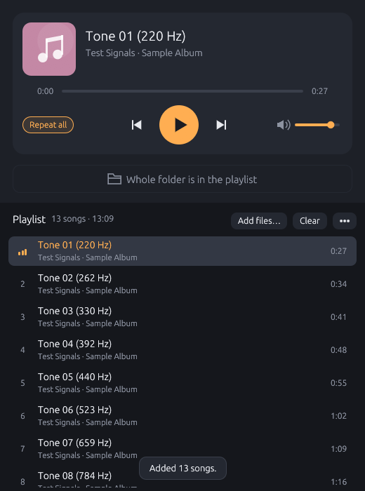

# Easy Player

A small desktop audio player for Linux (Rust, eframe/egui, rodio).

```bash
flatpak install --user https://hawwwran.github.io/hwnhub/com.hawwwran.EasyPlayer.flatpakref
```

- Drop songs or folders on the window to build a playlist.
- "Add whole folder" brings in the other songs from the playing song's folder,
  in folder order around it, so playback carries on with the next file.
- A song double-clicked in the file manager opens in an idle window, or in a
  new one if the open window is busy; starting playback pauses other windows.
- Keyboard media keys work through MPRIS. One player plays at a time, so the
  keys follow the player started last (see `src/peers.rs` for why).



## Building

```bash
sudo apt install libasound2-dev
cargo build --release
```

A build run from the checkout has an install entry in its ••• menu: it copies
the program to `~/.local/bin`, adds a launcher and icon
(`com.hawwwran.EasyPlayer`) and makes the player the default for audio files.
The Flatpak brings its own launcher and has no such entry.

`--screenshot <file.png>` draws about 120 frames, saves the window and exits
(no sound, no talking to other windows).

The Flatpak, built from the checkout and installed for the current user:

```bash
flatpak run org.flatpak.Builder --user --install --force-clean \
  temp/flatpak-build com.hawwwran.EasyPlayer.yaml
```

## Tests

```bash
python3 tools/make_test_audio.py     # test tones in test-audio/ (needs ffmpeg)
cargo test                           # logic, tags, window handover
cargo test -- --include-ignored      # + real sound output and session-bus tests
```

## Releasing

`.project-manager/release` bumps the version, builds the Flatpak and publishes
it to the [hwnhub](https://github.com/hawwwran/hwnhub) channel. It is written
for the author's release tool, which passes the version and the release notes
in `PM_*` variables.

## License

GPL-3.0-or-later, see [LICENSE](LICENSE).
